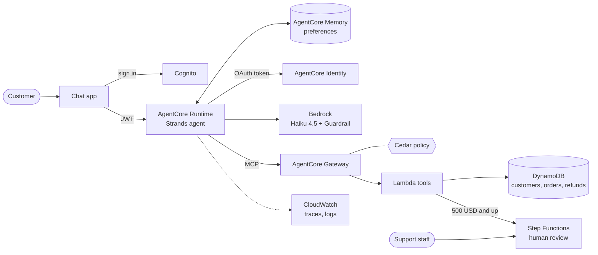
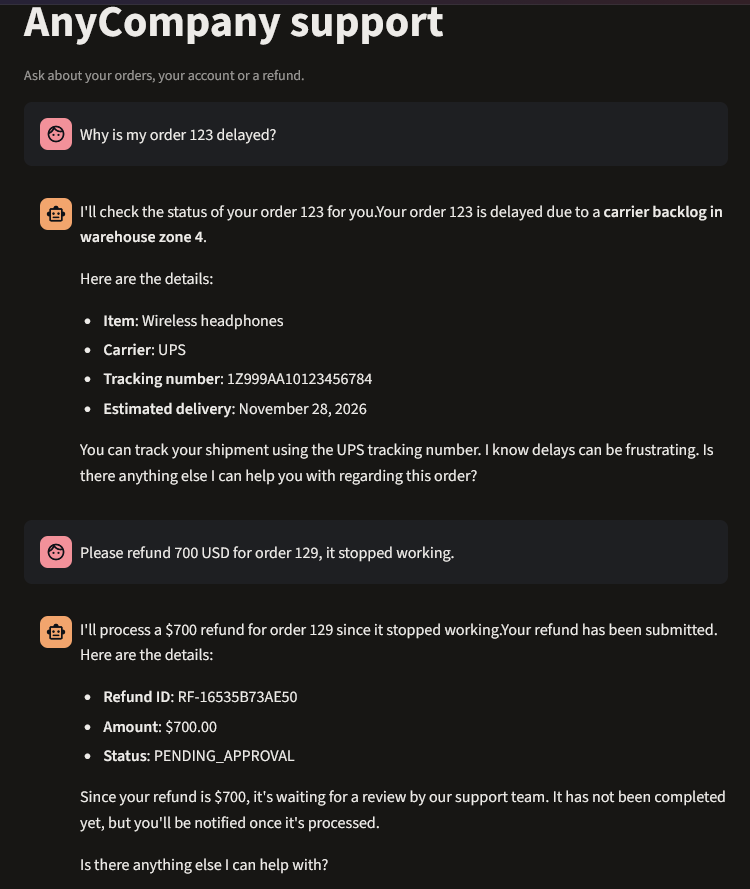
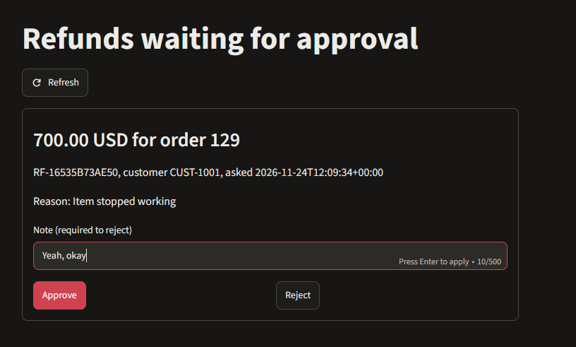

# AgentCore Customer Support Agent

[](https://github.com/Lukito2004/agentcore-support-agent/actions/workflows/ci.yml)

A production-like customer support agent on **Amazon Bedrock AgentCore** with **Strands**. It answers order and account questions, issues refunds and remembers customer preferences, and it cannot be talked into an unauthorized or duplicate refund: identity comes from the sign-in token, a Cedar policy at the Gateway denies refunds above 1,000 USD, refunds from 500 USD wait for a person, and every refund is idempotent.

## Architecture



Components, the request flow, state, trust boundaries, deployment and scaling: [docs/architecture.md](docs/architecture.md).

## Requirements and evidence

Every log below was produced by a script in [scripts](scripts) against the deployed system.

| Requirement | How | Evidence |
|---|---|---|
| Runtime + Strands | Strands agent on AgentCore Runtime, JWT inbound auth, one microVM per session | [runtime-session-isolation.txt](docs/evidence/runtime-session-isolation.txt) |
| Gateway + MCP, 2 to 3 business tools | `get_customer`, `get_order_status`, `refund_customer` as Lambda targets behind one MCP Gateway | [gateway-tools.txt](docs/evidence/gateway-tools.txt) |
| Agent checks an order | "Why is my order 123 delayed?" answered from DynamoDB | [gateway-tools.txt](docs/evidence/gateway-tools.txt), [screenshot](docs/evidence/screenshots/chat-order-status.png) |
| Agent retrieves customer information | `get_customer`, bound to the signed-in customer | [gateway-tools.txt](docs/evidence/gateway-tools.txt) |
| Agent processes a refund | completes at once, or waits for review from 500 USD | [gateway-tools.txt](docs/evidence/gateway-tools.txt), [refund-approval.txt](docs/evidence/refund-approval.txt) |
| Memory across two sessions | "My preferred AWS region is eu-west-1" recalled in a new session, not by another customer | [memory-across-sessions.txt](docs/evidence/memory-across-sessions.txt) |
| Identity / IAM, no long-lived credentials | Cognito JWT inbound; AgentCore Identity OAuth outbound; IAM roles everywhere else | [security.md](docs/security.md) |
| Refund ≤ 1,000 USD allowed | Cedar permit on `amount_cents <= 100000` | [policy-enforced.txt](docs/evidence/policy-enforced.txt) |
| Refund > 1,000 USD denied | the model's own `refund(5000)` and a direct one to the Gateway are both denied by Cedar by default; the trace shows `POLICY_DENIED` | [policy-enforced.txt](docs/evidence/policy-enforced.txt) |
| Prompt injection cannot bypass authorization | Guardrail, untrusted-content prompt, then Cedar, Lambda cap and human review regardless | [policy-enforced.txt](docs/evidence/policy-enforced.txt), [guardrail.txt](docs/evidence/guardrail.txt) |
| Retry does not duplicate a refund | idempotency key from code, conditional DynamoDB transaction, replay; the brief's `operation-123` sent twice to the deployed Gateway and in [unit tests](tests/unit/test_refund_tool.py) | [refund-retry-no-duplicate.txt](docs/evidence/refund-retry-no-duplicate.txt) |
| Errors and retries with backoff | structured tool errors, full-jitter backoff for retryable and safe calls, loop guard | [failure-drills.txt](docs/evidence/failure-drills.txt) |
| At least 3 failure scenarios | tool timeout, HTTP 500, Lambda crash, LLM loop, invalid parameters, malformed session ID, wrong tool selection | [failure-drills.txt](docs/evidence/failure-drills.txt), [wrong-tool-drill.txt](docs/evidence/wrong-tool-drill.txt) |
| Failures found with traces | six real failures found in traces and fixed, with before and after traces | [failure-scenarios.md](docs/failure-scenarios.md), [before](docs/evidence/failure-drills-before-fixes.txt) |
| Least privilege | one role per function with exact actions; explicit Denies narrow the CLI-generated runtime role; remaining gaps documented | [security.md](docs/security.md) |
| Policy + Cedar | default deny, `LOG_ONLY` then `ENFORCE` | [policies](policies), [policy-log-only.txt](docs/evidence/policy-log-only.txt) |

Beyond the brief: a Bedrock Guardrail, human review of large refunds, AgentCore Evaluations with a custom evaluator ([evaluations.md](docs/evaluations.md)), a chat app and a staff app, and CI.

## Screenshots

| Customer chat | Staff review |
|---|---|
|  |  |

More in [docs/evidence/screenshots](docs/evidence/screenshots).

## Repository

```
app/support_agent/   the Strands agent that runs on AgentCore Runtime
agentcore/           AgentCore CLI project: Runtime, Memory, Identity, Gateway, Policy, evaluator
policies/            Cedar policies for the Gateway
backend/             tool Lambdas, refund review steps, evaluator, tool schemas, demo data
infra/               CDK app for the business backend
ui/                  Streamlit chat app and staff app
scripts/             setup, test, trace and evaluation scripts
evals/               evaluation scenarios
tests/unit/          279 unit tests; run without AWS
docs/                design, security, setup, failures, evaluations, evidence
```

## Run it

Deploying needs an AWS account with Bedrock access, the AgentCore CLI, the AWS CDK and uv; the full order is in [docs/setup.md](docs/setup.md). Without AWS, the tests and lint run anywhere:

```powershell
uv sync
uv run pytest
uv run ruff check .
```

## Docs

- [architecture.md](docs/architecture.md): components, request flow, state, trust boundaries, identity, authorization, failure handling, observability, deployment, scaling
- [decisions.md](docs/decisions.md): why each service and pattern, the alternatives, the trade-offs, lessons from deploying
- [security.md](docs/security.md): threats and controls, least privilege, secrets, remaining risks
- [failure-scenarios.md](docs/failure-scenarios.md): failure drills and six failures found with traces
- [evaluations.md](docs/evaluations.md): AgentCore Evaluations results and what they changed
- [setup.md](docs/setup.md): deploy, test, run, tear down
