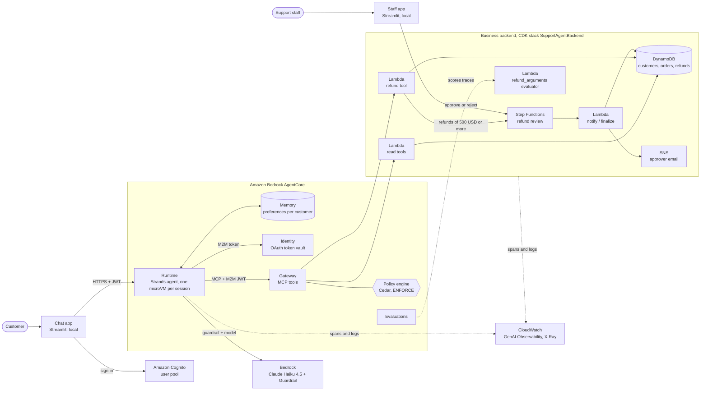
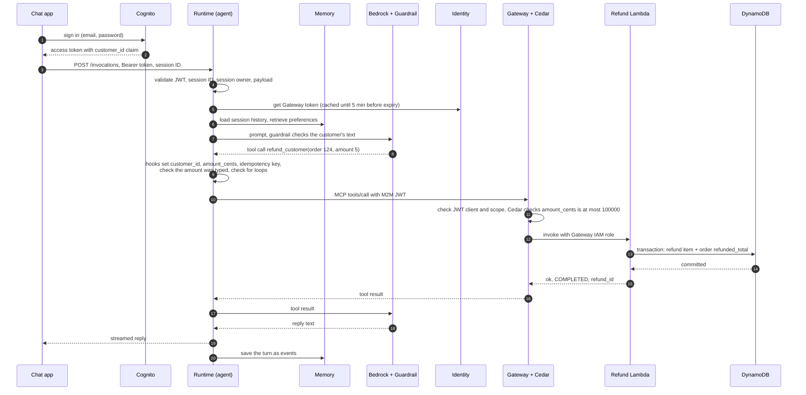

# Architecture

How the Customer Support Agent is built: the components, one request end to end, where state lives, the trust boundaries, and how it fails, is observed, is deployed and would scale. Design choices and their alternatives are in [decisions.md](decisions.md); threats and controls in [security.md](security.md).

## Components

| Component | Responsibility | Where it is defined |
|---|---|---|
| **AgentCore Runtime** | Hosts the agent in an isolated microVM per session, authenticates every request (`CUSTOM_JWT` against Cognito), scales sessions, keeps versions and endpoints | [agentcore.json](../agentcore/agentcore.json) |
| **Strands agent** | Prompt, model loop, tool calls; the code around it validates input, binds identity and enforces refund rules ([hooks.py](../app/support_agent/hooks.py), [guards.py](../app/support_agent/guards.py)) | [app/support_agent](../app/support_agent) |
| **AgentCore Memory** | Conversation events per session (kept 30 days) and long-term preferences per customer (`USER_PREFERENCE` strategy) | [agentcore.json](../agentcore/agentcore.json), [memory.py](../app/support_agent/memory.py) |
| **AgentCore Identity** | Holds the Gateway client secret in its token vault and hands the agent short-lived OAuth tokens (client credentials) | `credentials` in [agentcore.json](../agentcore/agentcore.json), [gateway.py](../app/support_agent/gateway.py) |
| **AgentCore Gateway** | One MCP endpoint for all tools, its own JWT authorizer, calls the Lambdas with its own IAM role | `agentCoreGateways` in [agentcore.json](../agentcore/agentcore.json) |
| **MCP** | The protocol between agent and Gateway: tool discovery (`tools/list`) and calls (`tools/call`) | [gateway.py](../app/support_agent/gateway.py) |
| **AgentCore Policy** | Cedar policies checked by the Gateway before any tool runs; anything not permitted is denied | [policies](../policies) |
| **Tool Lambdas** | Business APIs: `get_customer`, `get_order_status`, `refund_customer`; they never trust their input | [backend](../backend) |
| **DynamoDB** | The only source of truth for customers, orders and refunds | [data.py](../infra/support_backend/data.py) |
| **Refund review** | Step Functions waits for a human decision on refunds of 500 USD or more, with a 15 minute timeout | [approval.py](../infra/support_backend/approval.py) |
| **Bedrock Guardrail** | Screens what the customer types (prompt attacks, secrets, harmful content) and masks secrets in replies | [guardrail.py](../infra/support_backend/guardrail.py) |
| **Cognito** | Customer accounts (admin-created, each linked to one customer ID) and the agent's machine client for the Gateway | [identity.py](../infra/support_backend/identity.py) |
| **CloudWatch** | Traces (Session, Trace, Span), logs and metrics for the agent and the Lambdas | [failure-scenarios.md](failure-scenarios.md) |
| **AgentCore Evaluations** | Scores replayed sessions with built-in judges and our code-based evaluator | [evaluations.md](evaluations.md) |

## One request, end to end

"Please refund 5 USD for order 124, the mug arrived chipped."

With 700 USD, step 13 saves the refund as `PENDING_APPROVAL` instead, holds the amount on the order and starts the review; Step Functions emails the approver and the staff app shows it ([screenshots](evidence/screenshots)). With 5,000 USD the model still calls the tool, and step 11 denies it: Cedar finds no permit and denies by default. The agent records `POLICY_DENIED`, does not retry, and offers to escalate.

## State

| State | Where | Lifetime | Authoritative? |
|---|---|---|---|
| Conversation in progress | Strands agent in the session's microVM (last 20 messages) | the runtime session | no |
| Conversation events | AgentCore Memory, session = runtime session ID, actor = Cognito `sub` | 30 days | no |
| Customer preferences | AgentCore Memory namespace `/users/{actorId}/preferences` | until deleted | no, may be outdated |
| Customers, orders, refunds | DynamoDB, `refunded_total` and `pending_refund_total` on the order | permanent (PITR on) | **yes** |
| Refund under review | the refund item (`PENDING_APPROVAL`, callback token) and a Step Functions execution | until decided or 15 min | yes |
| Gateway access token | memory of the session's microVM | 60 min | no |
| Customer's tokens | chat app server memory, never the browser | 60 min, refresh 1 day | no |

The agent never answers from memory about orders or refunds: Memory keeps preferences only and the prompt says remembered context is never a source for business data. The first version also had a `SEMANTIC` strategy; it copied refund amounts and email addresses into long-term memory, which went stale and broke a retry test, so it was removed ([decisions.md](decisions.md)).

**Terms.**
- **Runtime session**: one conversation, one microVM, identified by a session ID of 33 or more characters. The agent binds a session to the first user who uses it.
- **Actor**: the person the memory is about; here the Cognito `sub` from the verified token.
- **Session (Memory)**: the conversation's events; it uses the runtime session ID.
- **Namespace**: the path long-term records are stored under, scoped per actor so customers never share memory.
- **Memory**: the resource (`supportMemory`) with its extraction strategy.
- **Memory vs RAG**: Memory stores and recalls what this customer said; RAG retrieves from shared documents. This agent has no document corpus, so it has no RAG.

## Trust boundaries

| Boundary | What crosses it | What is checked |
|---|---|---|
| Browser to chat app | email, password, messages | the app runs on `127.0.0.1` with XSRF protection; tokens stay on the server; replies are rendered without HTML |
| Client to Runtime | bearer token, session ID, payload | Runtime JWT authorizer (issuer, allowed client); the agent requires an access token with a `customer_id` claim, a valid session ID, the session's owner, and a payload of exactly one prompt string up to 4,000 characters |
| Customer text to model | the prompt | Guardrail (prompt attack, secrets, harmful content) on what the customer typed |
| Model to tools | tool calls | untrusted: hooks overwrite `customer_id`, compute `amount_cents` and the idempotency key, require a typed amount, stop loops |
| Runtime to Gateway | MCP calls | Gateway JWT authorizer (machine client and scope), then Cedar |
| Gateway to Lambdas | tool arguments | Gateway role may invoke only the two tool Lambdas; each Lambda validates every argument and the order's owner |
| Lambdas to DynamoDB | reads and conditional writes | per-function IAM with exact actions on exact tables |
| Tool results and memory to model | data | treated as data by the prompt; never instructions |
| Staff to review | approve or reject | the staff member's own AWS credentials; the callback token never leaves AWS |

## Identity

| Direction | Who | How | Credentials |
|---|---|---|---|
| Inbound | customer to Runtime | Cognito access token, checked by the Runtime's `CUSTOM_JWT` authorizer; `customer_id` added by a pre-token Lambda from an immutable attribute | none stored; tokens expire after 60 min |
| Outbound | agent to Gateway | OAuth2 client credentials through an AgentCore Identity credential provider; the agent gets a workload access token, then a Gateway token | client secret in the Identity token vault (Secrets Manager), never in code or the repo |
| Outbound | Gateway to Lambdas | the Gateway's IAM service role | temporary IAM credentials |
| Outbound | agent to Bedrock and Memory | the runtime's execution role | temporary IAM credentials |
| Staff | approver to AWS | their own IAM identity | their own profile |

**Inbound** authentication answers "who is calling the agent"; **outbound** answers "how does the agent prove itself to the services it calls". The customer's token never reaches the Gateway, and the agent's machine token cannot call the Runtime. The Gateway therefore sees the agent, not the customer: Cedar and the Lambdas rely on the `customer_id` the agent's code takes from the customer's token ([security.md](security.md), remaining risks).

## Authorization

| Layer | Enforces |
|---|---|
| Cognito and the Runtime authorizer | only signed-in customers of this app reach the agent |
| Agent code | identity comes from the token, not the payload; a session belongs to one user; tool calls are bound to the signed-in customer; refund amounts must be typed by the customer |
| Cedar at the Gateway | which tools may run at all, and refunds only up to 1,000 USD (`amount_cents <= 100000`); everything else is denied by default |
| Tool Lambdas | the order belongs to the customer, it is refundable, refunds never exceed the order total, the 1,000 USD cap again, `amount_cents` equals `amount` |
| Refund review | refunds that bring an order's refunds to 500 USD or more wait for a person |
| IAM | each function and role can touch only what it needs |

A system prompt is not enough because the model's output is untrusted: an injected instruction, a misread amount or a bug can make it ask for anything. The prompt only shapes good behavior and does not even state the refund limit; the Gateway policy and the Lambdas decide, whatever the model asks. The failure drills found exactly such a case: the model refunded 20 USD from "minus 5 dollars" until the code check was added ([failure-scenarios.md](failure-scenarios.md)).

## Failure handling, retries and idempotency

**Errors are structured.** Tool Lambdas never raise to Gateway; they return `{"ok": false, "error": {"code", "message", "retryable"}}` ([responses.py](../backend/common/responses.py)). An unexpected exception becomes a non-retryable `INTERNAL_ERROR`, with the stack trace only in the log ([dispatch.py](../backend/common/dispatch.py)). The entrypoint returns fixed error codes (`MISSING_SESSION`, `UNAUTHENTICATED`, `SESSION_FORBIDDEN`, `INVALID_REQUEST`, `TOOLS_UNAVAILABLE`, `INTERNAL_ERROR`) and never internal details.

**Retryable is not the same as safe to retry.** An error is retryable when it is transient (throttling, timeouts, `BACKEND_UNAVAILABLE`, Gateway's masked Lambda timeout). An operation is safe to retry when repeating it cannot do harm: reads always, and `refund_customer` only because every call carries an idempotency key computed by the agent's code. `RetryHook` retries only when both are true: 3 attempts with full-jitter exponential backoff ([reliability.py](../app/support_agent/reliability.py)). A Cedar deny is a decision, never retried.

**A refund that times out after it was saved.**
1. The idempotency key is `op-` plus a hash of actor, session, order and amount in cents, so the same request always has the same key, whatever the model writes.
2. The refund item is written with `attribute_not_exists(idempotency_key)` in the same DynamoDB transaction that raises the order's `refunded_total`, re-checking ownership, status and the order total.
3. If the response is lost (timeout), the retry sends the same key; the Lambda finds the stored refund, checks the request fingerprint (customer, order, amount) and returns the original result with `replayed: true`. Money moves once.
4. Two concurrent calls with the same key: one transaction wins, the other's condition fails and it returns the winner's result.

Evidence: [refund-retry-no-duplicate.txt](evidence/refund-retry-no-duplicate.txt) and the unit tests in [test_refund_tool.py](../tests/unit/test_refund_tool.py), including the brief's `operation-123` key, a commit followed by a timeout, and a concurrent duplicate.

**Other failures.** A loop guard cancels a third identical tool call and caps a turn at 8 calls. The review workflow retries its finalize step and expires a refund nobody decides on, giving the held amount back. Bedrock calls use adaptive client retries.

## Observability

- The Runtime exports OpenTelemetry (ADOT) spans, logs and metrics to CloudWatch; spans are in the runtime's log group, stream `spans`, and in the GenAI Observability console as Session, Trace and Span. The Lambdas use X-Ray active tracing and JSON logs.
- The agent adds span events for its own decisions: `support.tool_call`, `support.tool_result`, `support.tool_retry`, `support.loop_guard_blocked`, `support.refund_amount_blocked`, `support.request_failed`.
- Logs never contain prompts or raw user IDs: the agent logs the prompt length and a 12-character hash of the actor.
- [scripts/find_traces.py](../scripts/find_traces.py) prints a session's trace tree with failures marked.

**Troubleshooting a failed or slow tool call.** Find the session (the client's session ID), open its trace, and read the spans top down: `POST /invocations` for the whole request, `chat` for each model call, `execute_tool` for each tool attempt with its duration, status and result. The `support.*` events say what the agent's code decided.

| Failure | Where it shows |
|---|---|
| LLM | `chat` span: latency, tokens, `finish_reason` (`guardrail_intervened`, `max_tokens`); wrong tool or arguments in the next `execute_tool` |
| Tool or Gateway | `execute_tool` span with status ERROR, a long duration, or Gateway's "Please retry later"; retries as `support.tool_retry` |
| Backend | a tool result with `ok: false` and a business code (`BACKEND_UNAVAILABLE`, `ORDER_NOT_FOUND`), the Lambda's own X-Ray span and JSON log |
| Agent code | `support.request_failed`, `support.loop_guard_blocked`, `support.refund_amount_blocked`, or an exception event on a span |

Six real failures were found this way: [failure-scenarios.md](failure-scenarios.md).

## Deployment and rollback

Two deployables, each from code:

| What | Tool | Contains |
|---|---|---|
| Business backend | AWS CDK (Python), `cdk deploy` in [infra](../infra) | DynamoDB, tool Lambdas, Cognito, Guardrail, refund review, evaluator Lambda |
| Agent and AgentCore resources | AgentCore CLI 1.2.0, `agentcore deploy` | Runtime, Memory, Identity credential provider, Gateway and targets, policy engine and policies, evaluator registration |

**Versions.** Every `agentcore deploy` that changes the agent creates a new immutable Runtime version (version 16 at the time of writing). The `DEFAULT` endpoint follows the latest version; a named endpoint points at a fixed version. Guardrail versions are immutable too, and old ones are retained.

**Safe rollout.**
1. CI runs lint, formatting, 279 unit tests and `cdk synth` on every push.
2. Diff the synthesized CloudFormation against the deployed stack before deploying; AgentCore policies have no dry run.
3. Deploy, then run the scenario scripts and the evaluations against the new version.
4. In production, clients call a named endpoint (`agentcore add runtime-endpoint --runtime support_agent --name prod --version N`), not `DEFAULT`. A new version is tested on `DEFAULT` or a `staging` endpoint, then `prod` is moved to it.
5. New Cedar policies start in `LOG_ONLY` and switch to `ENFORCE` once the logs show the expected decisions; this project did exactly that ([policy-log-only.txt](evidence/policy-log-only.txt), [policy-enforced.txt](evidence/policy-enforced.txt)).

**Rollback.** Point `prod` back to the previous Runtime version (no rebuild), set `GUARDRAIL_VERSION` back to the previous guardrail version, or redeploy the previous commit with CDK. Business data survives all of these; DynamoDB has point-in-time recovery. The demo tables use `RemovalPolicy.DESTROY` so the project can be torn down cleanly; production tables would be `RETAIN`.

## Scaling to 10x traffic

| Part | What happens | What to do |
|---|---|---|
| Runtime | one microVM per session, scaled by AWS | raise the concurrent session quota; nothing else to manage |
| Bedrock | the first limit to hit: tokens per minute | request quota increases; the `us.` cross-region inference profile already spreads load; adaptive retries absorb throttling; consider prompt caching |
| Guardrail | text units per second | request a quota increase alongside Bedrock |
| Gateway, Policy, Identity, Memory | managed, scale with requests | check service quotas; the agent caches the Gateway token per session |
| Lambdas | concurrency | within the default account limit; reserved concurrency if one tool needs protecting |
| DynamoDB | on-demand, keyed by order and idempotency key | scales without capacity planning; no hot keys at normal order volumes |
| Cognito | sign-ins and token refreshes | quotas are per second; refresh tokens keep sign-ins rare |
| Refund review | Step Functions standard | scales; the limit is people, so the 500 USD threshold may need tuning |
| Observability | 10x spans and logs | sample traces (span indexing is at 100% now) and keep log retention short |
| Cost | dominated by model tokens | Haiku by default; evaluations online on a sample, not every session |

Before a 10x increase: a load test of the scenario mix, CloudWatch alarms on errors, latency and throttles, and a budget alert.

## Cost

Everything is pay per use; idle cost is near zero apart from small storage and logs. Model tokens are the main cost of a conversation. A full run of the test scripts or the evaluations costs cents. See the README for teardown.
